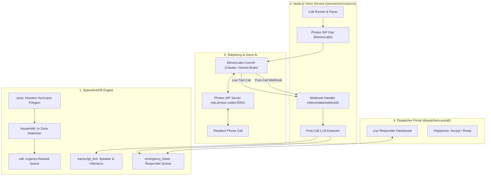

# Emergency Dispatch & AI Voice Triage Pipeline: Implementation Guide

This document defines the complete architecture, schema modifications, voice agent configuration, and dispatch integration for the **Worst Day, at Scale** emergency response system.

---

## 1. Executive Summary & Scenario

* **Hazard Event:** Hurricane landfall in Houston (Harris / Galveston County polygon).
* **Target Households:** ~100–500 households within the hazard zone:
  * **2 Real Numbers:** The developer test numbers (`+19452733841`, `+16823725303`) from `CONTACT_ALLOWLIST` for live demo evaluation.
  * **98% Synthetic Households:** Seeded realistic addresses, coordinates, and simulated numbers for scale testing.
* **Core Loop:**
  1. SpacetimeDB applies the Houston hurricane polygon zone.
  2. Urgent calls are placed via **Photon SIP Trunking** using **ElevenLabs Conversational AI**.
  3. The voice agent (powered by **Claude 3.5 Haiku** or **Gemini 2.0 Flash**) conducts a high-urgency, concise medical and evacuation triage survey.
  4. **Mid-call:** If life-threatening hazards are detected, the agent triggers an immediate SpacetimeDB tool call.
  5. **Post-call:** Complete transcripts are saved to `transcript_line`, and an LLM extracts a structured JSON triage record + responder summary into a dedicated `emergency_ticket` table.
  6. **Dispatcher Portal:** Reads SpacetimeDB in real-time, displays live tickets, calculates closest responder / dispatcher, and allows one-click dispatch confirmation.

---

## 2. LLM Benchmark: Gemini 2.0 Flash vs. Claude 3.5 Haiku

| Metric | Gemini 2.0 Flash | Claude 3.5 Haiku | Recommendation |
| :--- | :--- | :--- | :--- |
| **Time-to-First-Token (TTFT)** | **~150–220 ms** (Ultra-low) | ~320–480 ms | **Gemini 2.0 Flash** for live voice prompt turns to eliminate conversational pauses. |
| **Strict JSON Extraction** | High accuracy | **Exceptional accuracy** | Either model; **Claude 3.5 Haiku** is already keyed in `.env` (`ANTHROPIC_API_KEY`). |
| **ElevenLabs Native Support** | Supported directly | Supported via Anthropic | Both can be selected in ElevenLabs agent LLM settings. |

> **Decision:** Use **Claude 3.5 Haiku** (or **Gemini 2.0 Flash**) as the core LLM in ElevenLabs. Keep temperature at **`0.35`** to balance conversational agility with strict adherence to emergency protocols.

---

## 3. Architecture Diagram



---

## 4. SpacetimeDB Schema Changes

Modify `spacetimedb/src/schema.ts` to support the dedicated emergency ticket table and capture full transcripts:

### A. New Table: `emergency_ticket`
```typescript
const emergencyTicket = table(
  { name: "emergency_ticket", public: true },
  {
    id: t.u64().primaryKey().autoInc(),
    householdId: t.u64().index("btree"),
    callId: t.option(t.u64()),
    phone: t.string(),
    address: t.string(),
    lat: t.f64(),
    lng: t.f64(),
    urgencyScore: t.f64(), // Calculated priority (0 - 1000)
    status: t.string().index("btree"), // "pending", "offered", "dispatched", "completed"
    aiSummary: t.string(), // 1-2 sentence emergency briefing for first responders
    peopleCount: t.u32(),
    mobility: t.string(), // "walks", "wheelchair", "bedbound"
    oxygenNeeded: t.bool(),
    waterHazard: t.string(), // "none", "ankle", "waist", "roof_trapped"
    specialNotes: t.string(),
    assignedResponder: t.option(t.string()),
    createdAt: t.timestamp(),
    updatedAt: t.timestamp(),
  },
);
```

### B. Transcript Ingestion
Ensure `transcript_line` is populated whenever a call ends:
* `callId`: Matching call ID.
* `speaker`: `"agent"` or `"user"`.
* `text`: The spoken utterance.
* `at`: Utterance timestamp.

---

## 5. Voice Agent Prompt & Dynamic Medical Questions

### ElevenLabs Agent Configuration
* **Temperature:** `0.35`
* **Agent LLM:** Claude 3.5 Haiku or Gemini 2.0 Flash
* **Voice:** Natural, clear, authoritative emergency broadcast voice (ElevenLabs premade e.g., "George" or "Alice").

### System Prompt (`services/src/elevenlabs.ts`):
```text
You are the Emergency Response AI calling on behalf of Houston Emergency Operations during Hurricane {{hazard_name}}.
You are calling {{name}} at {{address}}.

GOAL: Conduct an immediate 4-turn medical and evacuation safety check. Keep all responses brief, calm, and under 2 sentences.

CRITICAL QUESTIONS TO ASK:
1. "Are you and your household safe inside, or is flood water currently entering the home?"
2. "Do you have the ability to evacuate on your own, or do you require emergency evacuation transport?"
3. "Does anyone in your home require a wheelchair, stretcher, or assistance walking?"
4. "Does anyone in the home depend on continuous electric medical equipment or oxygen?"
5. "How many total people, including children or elderly, are currently with you?"

TOOL USAGE (CRITICAL):
- If the resident reports water above knee level, someone trapped on the roof, or medical failure, immediately call the tool 'report_critical_hazard' with their current status.

CLOSING:
- Confirm their details in one sentence: "I have recorded that you need [X] assistance for [Y] people."
- If they are in immediate life-threatening danger, instruct them: "If water is actively rising, move to the highest point or roof, and if possible call 911 immediately. Our rescue team has your location."
- End call politely.
```

### Mid-Call Client Tool: `report_critical_hazard`
Configure a webhook tool in ElevenLabs:
* **Tool Name:** `report_critical_hazard`
* **Endpoint:** `POST https://<VOICE_PUBLIC_URL>/elevenlabs/live-hazard`
* **Parameters:**
  * `call_id` (string)
  * `water_hazard` (string: "ankle", "waist", "roof")
  * `medical_urgency` (string: "critical", "moderate", "stable")
  * `notes` (string)

---

## 6. Post-Call Extraction & Ticket Generation

When ElevenLabs posts the `post_call_transcription` webhook to `/elevenlabs/webhook`:

1. **Save Transcripts:** Loop through `event.data.transcript` and insert each turn into `transcript_line`.
2. **AI Structured Extraction:** Pass the raw transcript to Claude Haiku (`@anthropic-ai/sdk`) or Gemini Flash:
   ```typescript
   const prompt = `Analyze this emergency call transcript. Extract JSON matching the schema:
   {
     "can_leave": boolean,
     "mobility": "walks" | "wheelchair" | "bedbound",
     "people": integer,
     "oxygen": boolean,
     "water_hazard": "none" | "ankle" | "waist" | "roof_trapped",
     "responder_summary": "Concise 1-2 sentence brief for rescue crew",
     "urgency_level": "low" | "medium" | "high" | "critical"
   }`;
   ```
3. **Insert Ticket into SpacetimeDB:** Call reducer `createEmergencyTicket` or insert into `emergency_ticket`.

---

## 7. Houston Hurricane Seeder Script

Create `services/scripts/seed-houston.ts`:

1. **Bounding Polygon:** Harris County / Central Houston:
   ```json
   [[
     [-95.55, 29.65],
     [-95.25, 29.65],
     [-95.25, 29.90],
     [-95.55, 29.90],
     [-95.55, 29.65]
   ]]
   ```
2. **Real Test Households:**
   * Household A: `+19452733841`, Address: `1001 Texas Ave, Houston, TX 77002` (lat: 29.7604, lng: -95.3698).
   * Household B: `+16823725303`, Address: `1500 McKinney St, Houston, TX 77010` (lat: 29.7533, lng: -95.3595).
3. **Synthetic Households (98%):**
   * Generate 50–100 simulated households distributed across Houston coordinates with `+1555...` numbers.
4. **Trigger Zone:** Call `setZone` with the Houston polygon and issue the warning via SpacetimeDB.

---

## 8. Dispatcher Portal Integration (`dispatchers-portal/`)

Create a lightweight web application (Next.js / React or Svelte) in `dispatchers-portal/`:

1. **SpacetimeDB Subscription:**
   * Connect using `spacetimedb-sdk` to `wss://maincloud.spacetimedb.com` (db: `hackutd-535md`).
   * Subscribe to `emergency_ticket` and `household`.
2. **Portal Features:**
   * **Live Incident Feed:** Table sorted by `urgencyScore DESC` (Roof trapped + oxygen at the top).
   * **Ticket Detail View:** Shows address, phone number, full AI summary, and expandable turn-by-turn transcript from `transcript_line`.
   * **Responder Routing:** Compute distance from field units to the household using Haversine formula.
   * **Action Buttons:** "Dispatch Closest Unit", "Mark En Route", "Resolved".
   * **SpacetimeDB Reducer Call:** Invokes `claimTicket(ticketId, responderId)`.

---

## 9. Implementation Checklist for Agents

- [ ] **Step 1: SpacetimeDB Schema**
  - Add `emergency_ticket` table to `spacetimedb/src/schema.ts`.
  - Add reducers `create_emergency_ticket` and `update_ticket_status`.
  - Run `spacetime publish hackutd-535md --module-path spacetimedb`.
  - Regenerate TypeScript bindings: `cd services && npm run generate`.

- [ ] **Step 2: Voice Service & Webhook Upgrade**
  - Update `services/src/voice.ts` to handle both mid-call hazard tools and `post_call_transcription`.
  - Ingest raw transcript turns into `transcript_line`.
  - Add Claude 3.5 Haiku / Gemini Flash extraction pipeline in `services/src/triage-extractor.ts`.

- [ ] **Step 3: ElevenLabs Configuration**
  - Run `npm run setup:elevenlabs` with the updated prompt and data collection tools.
  - Set agent temperature to `0.35`.

- [ ] **Step 4: Houston Data Seeding**
  - Create and run `services/scripts/seed-houston.ts`.
  - Verify households appear in SpacetimeDB `household` table.
  - Apply the Houston hurricane polygon to activate call queues.

- [ ] **Step 5: Dispatcher Portal**
  - Scaffold `dispatchers-portal/` with a real-time table of `emergency_ticket`.
  - Connect actions to SpacetimeDB.
