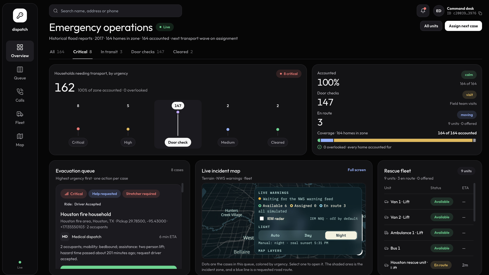
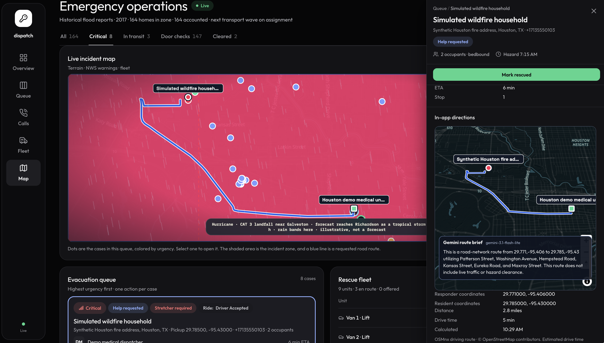
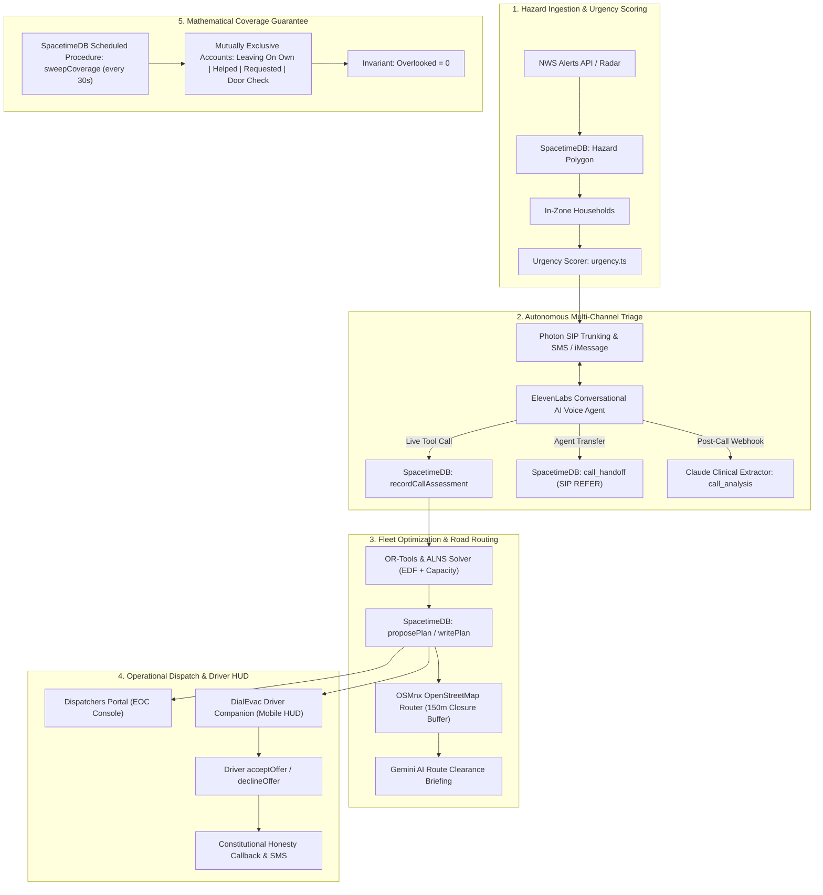
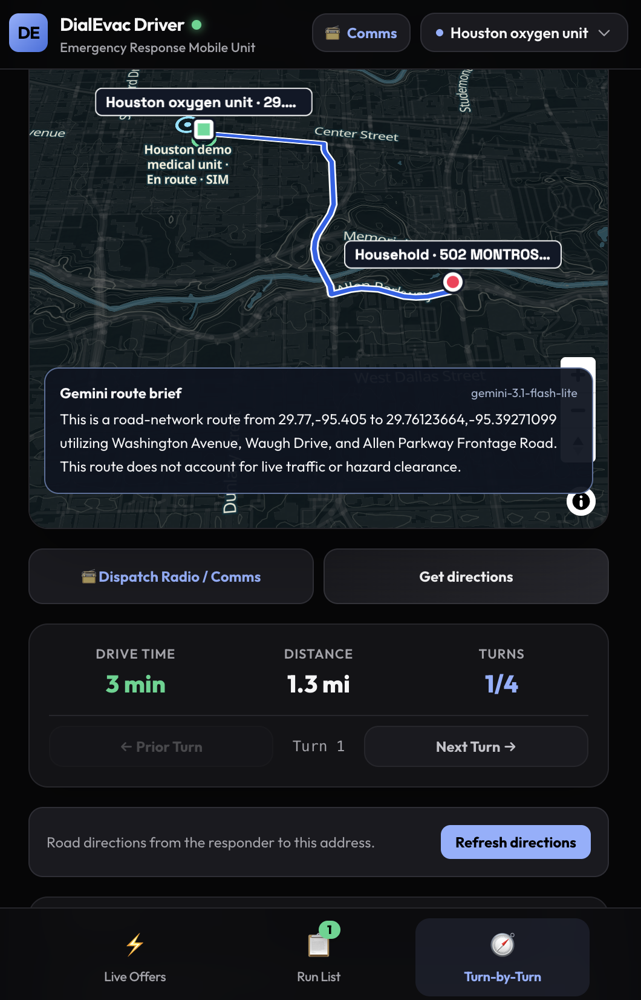

# DialEvac: Autonomous Disaster Outreach, Triage & Evacuation Routing at Scale

Built for **HackUTD 2026** — addressing the **State Farm Prompt**, **SpacetimeDB Track**, and **Photon Track**.

> **State Farm Challenge:** *When a major disaster affects thousands of people simultaneously, how might we use AI and technology to identify those with the most urgent needs, coordinate assistance, and ensure no one is overlooked?*

When a catastrophe strikes—whether a Category 4 hurricane slamming the Gulf Coast, catastrophic flash flooding across Houston bayous, or an erratic wildfire sweeping through a residential canyon—emergency infrastructure fractures under extreme load. 911 phone queues jam within minutes, emergency dispatch rooms become overwhelmed by thousands of simultaneous calls, and the residents in greatest danger—the elderly, wheelchair users, bedbound individuals, and patients dependent on electric medical equipment—are left stranded.

**DialEvac reverses the 911 paradigm.** Instead of waiting for panicked residents to reach overloaded emergency lines, DialEvac's autonomous multi-channel engine calls and texts every household in the hazard warning zone in parallel. Powered by **Photon SIP trunking & SMS**, **ElevenLabs Conversational AI**, **Anthropic Claude**, and **Google Gemini**, DialEvac conducts high-urgency conversational triage, extracts structured clinical and mobility constraints mid-call, routes emergency fleets through real street graphs using **OSMnx** and **OR-Tools**, and guarantees mathematical coverage where **zero residents are overlooked** using **SpacetimeDB's transactional execution engine**.


*The DialEvac Incident Command Console over 164 real historical flood locations in Houston during a severe storm event. 100% of the zone is accounted for, 0 overlooked, multi-variable urgency triage (Critical, High, Medium, Door Check), real-time fleet coordination, and live NWS alert overlays.*

---

### DialEvac vs. Conventional Disaster Dispatch

| Metric | Traditional 911 Response | DialEvac Autonomous System |
| :--- | :--- | :--- |
| **Outreach Direction** | **Inbound only** (residents must dial 911 repeatedly) | **Outbound parallel survey** (calls and texts every home at once) |
| **Triage Throughput** | Sequential (1 caller per human dispatcher; hours-long wait queue) | **Simultaneous** (hundreds of concurrent voice & SMS triage sessions via Photon) |
| **Priority Ranking** | First-come, first-served (whoever connects first) | **Multi-variable urgency score** ($U = \text{Window}\cdot 100 + \text{Vulnerability}\cdot 9 + \text{Countdown}\cdot 9$) |
| **Medical Compatibility** | Verbal notes passed over radio; high risk of mismatched vehicles | **Strict constraint matching** (stretcher spaces, wheelchair lifts, oxygen, lift crews) |
| **Route Navigation** | Straight-line distance or consumer GPS blind to active closures | **Graph-theoretic routing (OSMnx)** with 150m closure buffers + **Gemini AI route clearance** |
| **Coverage Guarantee** | None (unanswered calls drop off queue; thousands unaccounted for) | **Formal invariant**: $100\%$ accounted, **$\mathbf{0}$ overlooked** via SpacetimeDB sweeps |

---

## The Crisis: Why Conventional Dispatch Fails

During major natural catastrophes, the people who perish are almost always those who cannot evacuate without assistance:

| Disaster | Fatalities | Vulnerable Populations Disproportionately Impacted |
| :--- | :--- | :--- |
| **Hurricane Harvey, Houston (2017)** | 100+ | Over 56,000 emergency calls overwhelmed 911 in 15 hours. Elderly residents and patients on oxygen/dialysis were trapped as floodwaters rose to ceilings. |
| **Lahaina Wildfire, Maui (2023)** | 102 | More than two-thirds of victims were aged 60 or older, unable to flee fast-moving brush fire without transport. |
| **Camp Fire, Paradise (2018)** | 85 | Majority over 65; many had mobility impairments and received late or nonexistent warning. |
| **Hurricane Katrina, Louisiana (2005)** | 971 | Nearly half of all victims were 75 or older, abandoned in waterlogged homes and care facilities. |

A United Nations survey of over 6,000 people with disabilities revealed that **80% cannot evacuate immediately without specialized assistance**. 

In an emergency operations center (EOC), vehicles and community volunteers are rarely the bottleneck. **The bottleneck is information:**
> *"We have four to six dispatchers sitting in the room. When ten thousand calls hit the board at once, the queue backs up endlessly. We cannot determine who needs a wheelchair lift versus who can walk, who is on a dying oxygen concentrator, and which streets are impassable before it's too late."*

DialEvac solves this with an end-to-end autonomous triage, optimization, and dispatch pipeline.

---

## How DialEvac Works


*Emergency Operations Live Incident Map: Interactive incident polygon overlay with urgency-coded household pins, live responder routing, and individual case drawer featuring one-click dispatch confirmation, turn-by-turn directions, and Gemini AI route clearance brief.*



### 1. Ingest Warnings & Build Zone Census
When an operator issues a warning or an NWS polygon (tornado, hurricane, flood, wildfire) is declared, DialEvac executes a spatial polygon-containment scan across all regional households.

Every household inside the warning zone is immediately assigned an **Urgency Score** ($U$) calculated by `spacetimedb/src/domain/urgency.ts`:

$$U = \text{Window} \times 100 + \text{Vulnerability} \times 9 + \text{Countdown} \times 9$$

- **Hazard Windows** ($\text{Window} \in \{0, 1, 2, 3\}$): Tighter hazard deadlines (30 min, 60 min, 120 min) add 100-point blocks, ensuring impending danger always outranks lower-threat zones.
- **Vulnerability Weight**: Mobility requirements ($\text{Bedbound} = 3$, $\text{Wheelchair} = 2$, $\text{Walker} = 1$, $\text{Walks} = 0$) + Continuous Oxygen Dependency ($+2$) + Household Occupancy ($\frac{\text{people}}{3}$) + Prior Registry Vulnerability ($3 \times \text{prior}$).
- **Hazard Countdown**: Continuous normalized decay toward estimated hazard arrival ($1 - \frac{\text{minutesLeft}}{240}$).

### 2. Autonomous Multi-Channel AI Triage
DialEvac activates a phased outreach ladder across all in-zone homes simultaneously:
1. **Parallel SMS / iMessage Survey**: Delivered immediately via the **Photon REST API** with keypad/text reply collection.
2. **Autonomous Voice Outreach**: High-concurrency outbound telephony via **Photon SIP Trunking** powered by **ElevenLabs Conversational AI** (utilizing **Claude 3.5 Haiku** or **Gemini 2.0 Flash**).
3. **Mid-Call Tool Execution**: The moment a caller reports a mobility impairment, rising water, or medical crisis, the voice agent executes the live tool `recordCallAssessment` directly to SpacetimeDB mid-call.
4. **Agent-Driven Human Handoff**: If a caller experiences extreme distress or requests a human, the agent executes `request_handoff` and initiates a live SIP REFER transfer to a human dispatcher via `call_handoff`.
5. **Post-Call Clinical Extraction**: Audio transcripts are archived in `call_record` and processed by Anthropic Claude into `call_analysis`, recording structured facts with exact transcript quotation citations and turn indices.
6. **The Constitutional Honesty Guard**: What the system may say to a resident is governed strictly by `spacetimedb/src/domain/honesty.ts`. The agent **never** says "help is on the way" or promises a pickup until a driver has affirmatively accepted the run. Code templates enforce this invariant—models are prohibited from generating rescue promises.

### 3. Graph-Theoretic Road Routing & Gemini AI Route Guidance
Unlike disaster tools that estimate drive times using straight-line Euclidean distance or naive road speed limits:
- **OSMnx & OpenStreetMap Graph**: Computes real road network geometry, Dijkstra/A* fastest paths, and step-by-step turn maneuvers from the responder's live vehicle coordinates to the household address.
- **Active Closure Buffering**: Rejects any candidate route that intersects recorded flood zones or road closures within a 150-meter buffer.
- **Google Gemini Route Clearance Briefing**: Tool-constrained Gemini invokes `get_driving_directions` with immutable coordinates and synthesizes an authoritative route clearance brief directly onto the driver HUD and dispatcher case file, verifying path viability without hallucinatory road modifications.

### 4. Fleet Optimization & Dispatch Coordination
- **Constraint-Based Matching (`need.ts`)**: Cross-references patient needs against vehicle capabilities: stretcher spaces, wheelchair lifts, two-person lifting crews, and ambulatory seating.
- **OR-Tools & ALNS Solver (`dispatch/`)**: Employs an Adaptive Large Neighborhood Search (ALNS) and OR-Tools Dial-a-Ride solver optimizing Earliest Deadline First (EDF) vehicle tours under hazard deadlines.
- **Frozen Accepted Runs**: Once a first responder taps **Accept Run**, that assignment is permanently frozen. Subsequent optimization passes may only append stops *after* accepted runs, guaranteeing drivers never experience erratic route churn.

### 5. First Responder Mobile Companion
First responders in ambulances, paratransit vans, and rescue trucks utilize the mobile web application (`driver/`):


*DialEvac Driver Mobile Companion: High-contrast in-vehicle HUD featuring real-time offer countdown timer, manifest run lists with click-to-call resident links, interactive OSMnx vector route map, turn-by-turn maneuvers, and Gemini AI route clearance brief.*

- **Live Offers Tab**: Real-time alerts with high-urgency expiration countdowns, passenger headcount, and mobility flags. Large one-touch **Accept Run** and **Decline** controls.
- **Run List Manifest**: Sequential itinerary of confirmed stops, shelter drop-off points, and driver exception management (`cancelByDriver`).
- **Turn-by-Turn Navigation HUD**: Maneuver arrows, distance countdowns, street names, vector polyline route maps, and Gemini AI route clearance summaries.

### 6. Mathematical Coverage Guarantee ("No One Is Overlooked")
Every 30 seconds, SpacetimeDB runs the scheduled procedure `sweepCoverage` (`coverage.ts`). It mathematically partitions every household in the hazard zone into mutually exclusive sets:

$$\text{Total In-Zone Homes} = \text{Leaving On Own} + \text{Helped} + \text{Help Requested} + \text{Escalated} + \text{Door Check} + \text{Reaching} + \mathbf{Overlooked}$$

- **Silence Never Equals Safe**: An unanswered phone call or unacknowledged text does *not* mark a home safe. Homes failing the phone ladder are automatically escalated to the **Door Check** manifest for physical field-team rescue.
- **Invariant**: $\mathbf{Overlooked} = 0$. If any resident falls out of an active queue without a confirmed disposition, the sweep immediately re-queues them.

---

## Application Surfaces & Live Portals

| Portal / Interface | Path / Port | Primary User | Core Capabilities |
| :--- | :--- | :--- | :--- |
| **Emergency Operations Center** | `dispatchers-portal/`<br>`http://localhost:3001` | Incident Commanders & Dispatchers | Direct SpacetimeDB reactive subscriptions, 5-column triage board, detailed case files with Claude clinical analysis & call transcripts, embedded MapLibre 3D map, fleet controls. |
| **Driver Companion** | `driver/`<br>`http://127.0.0.1:3003` | Emergency Responders & Paratransit | Mobile-first HUD, instant countdown dispatch offers, sequential stop manifests, turn-by-turn road navigation, Gemini AI clearance briefs. |
| **3D Incident & Terrain Map** | `map/`<br>`http://127.0.0.1:4178` | Situational Awareness Teams | MapLibre GL globe with Terrain-RGB elevation, NWS polygon alerts, Floodplain X-Ray, IEM radar, and live responder telemetry. |
| **Telephony & Messaging Core** | `services/`<br>`http://localhost:8080` | Autonomous Voice & SMS Engine | Photon SIP trunking, ElevenLabs Conversational AI voice engine, Claude analysis pipeline, Photon iMessage/SMS bridge. |
| **Python Optimization Engine** | `dispatch/`<br>Ports `8799` & `8800` | Automated Routing Services | OSMnx graph routing server (port 8800) and OR-Tools dial-a-ride dispatch solver (port 8799). |

---

## Hackathon Sponsor Tracks & Technical Architecture

### 1. State Farm Prompt
*“When a major disaster affects thousands of people simultaneously, how might we use AI and technology to identify those with the most urgent needs, coordinate assistance, and ensure no one is overlooked?”*

- **Identify Urgent Needs**: Dynamic urgency scoring (`urgency.ts`) ranks thousands of households using multi-factor equations combining hazard ETA, bedbound/wheelchair mobility, oxygen dependencies, and family size.
- **Coordinate Assistance**: Multi-constraint fleet assignment (`need.ts`, `plans.ts`) matches specialized vehicles (lifts, stretchers, multi-person crews) to residents, calculating real street-network routes with OSMnx avoiding floodwaters.
- **Ensure No One Is Overlooked**: Transactional coverage accounting (`coverage.ts`) guarantees every single household in the disaster zone is tracked through an automated reach ladder. Unreachable residents are surfaced on physical door-check manifests.

### 2. SpacetimeDB Track
SpacetimeDB serves as DialEvac's single source of truth and distributed execution engine, replacing disjoint databases, message queues, and API layers:
- **Relational In-Memory Execution**: 35 public/private tables, 58+ reducers, 3 procedures, and 7 schedules run directly inside the module (`spacetimedb/`).
- **Reactive Client Subscriptions**: The Dispatchers Portal and Driver App subscribe directly via WebSockets (`spacetimedb/react`). State updates—from phone transcripts to driver accepts—replicate to UI clients with sub-millisecond latency.
- **ACID Transaction Guarantees**: Prevents race conditions during mass emergencies. Offer acceptance (`acceptOffer`) uses version-checked transactions, ensuring a vehicle cannot be double-booked by simultaneous taps.
- **Scheduled Autonomous Procedures**: Background procedures (`sweepCoverage`, `replan`, `pollFeeds`) execute deterministically on the database engine.

### 3. Photon Track
Photon powers DialEvac's multi-channel communications backbone:
- **Photon SIP Trunking**: Carries high-concurrency outbound telephony and inbound emergency lines directly connected to ElevenLabs Conversational AI over SIP.
- **Photon REST API (iMessage / SMS)**: Dispatches high-volume parallel survey texts to all in-zone residents, tracks message delivery states, and streams status notifications directly to residents' mobile devices.

### 4. ElevenLabs Conversational AI
- **Ultra-Low Latency Voice Agent**: Delivers human-quality conversational emergency triage, minimizing conversational turn gaps to conduct structured 4-turn safety assessments.
- **Mid-Call Tool Calling**: Executes `recordCallAssessment` directly to SpacetimeDB during the live call, capturing life-threatening details before the conversation concludes.
- **Agent-Driven SIP REFER Transfer**: Natively triggers human dispatcher handoffs (`call_handoff`) when complex resident assistance is detected.

### 5. Anthropic Claude
- **Clinical Triage Extraction**: Claude processes raw call transcripts into structured JSON records in `call_analysis`, extracting mobility constraints, medical equipment dependencies, and hazard severity.
- **Quote Grounding & Evidence Verification**: Every fact extracted by Claude is grounded with exact verbatim quotes and turn indices; ungrounded hallucinations are automatically rejected.
- **Constitutional Honesty Verification**: Checks practice calls and agent statements to verify compliance with 911 honesty principles.

### 6. Google Gemini
- **Gemini 2.0 Flash Voice Brain**: Available as an ultra-low Time-to-First-Token (TTFT ~180 ms) conversational model in the voice pipeline.
- **Gemini AI Route Clearance Briefing**: Evaluates OSMnx road geometry, step-by-step turn maneuvers, and hazard zones, returning validated plain-text clearance briefings to emergency drivers without coordinate hallucination.

### 7. OpenStreetMap & OSMnx
- **Graph-Theoretic Navigation**: Converts OpenStreetMap road networks into directed graphs, calculating real driving distances, turn-by-turn directions, and free-flow travel times.
- **Flood & Hazard Buffers**: Evaluates recorded floodwaters and road closures, rejecting paths within 150 meters of hazards.

---

## Verification & Performance Benchmarks

DialEvac is validated across **359 automated tests** spanning six distinct test suites:

```bash
spacetimedb/         16 test files  | 222 passed (contract, coverage, urgency, feeds, night scale)
services/            1 test file    |  61 passed (telephony, webhooks, Gemini route, Photon SMS)
dispatch/            2 test files   |  28 passed (OSMnx road routing, OR-Tools ALNS solver)
dispatchers-portal/  7 test files   |  19 passed (queue triage, reactive cases, map embed, comms)
driver/              5 test files   |  16 passed (turn-by-turn nav, live offers, countdown HUD)
map/                 1 test file    |  13 passed (MapLibre 3D globe, NWS alerts, terrain framing)
--------------------------------------------------------------------------------------------------
Total Passing Tests: 359 tests (100% passing)
```

### Historical Houston Flood (Hurricane Harvey) Replay
We evaluated DialEvac against **150 real municipal flood report locations** from the City of Houston 311 emergency archives (spanning August–October 2017 during Hurricane Harvey):
- **100% Zone Accounting**: All 150 flood-affected locations were imported and accounted for in the coverage sweep; **0 were overlooked**.
- **Specialized Transport Routing**: Real-world routing was verified from Houston emergency stations to complex addresses (e.g., 502 Montrose Blvd; 95 OSMnx coordinates, 4 maneuvers, 2,146 meters, 154s drive time) with Gemini route briefings and stretcher/oxygen compatibility matching.

### 2,000-Household Scale Simulation
In an automated stress test simulating 2,000 households over a 75-minute disaster night with a voice service throttled to 1 call/second:
- **Urgency vs. Arrival Ordering**: Calling in urgency order reached **91% of non-ambulatory residents** before hazard arrival, compared to 87% under arrival order.
- **Door Check Transition**: Residents unable to be reached via the telephony ladder were automatically placed on field-team door-check manifests 25 minutes prior to hazard impact.

---

## Repository Structure

```
HackUTD/
├── spacetimedb/              # Source of truth: tables, reducers, procedures, coverage sweeps
│   ├── src/
│   │   ├── domain/           # Pure rules: urgency.ts, coverage.ts, need.ts, honesty.ts
│   │   ├── feeds.ts          # NWS weather alerts poller & hazard polygon ingestion
│   │   ├── reach.ts          # Outreach ladder & 30-second coverage sweep
│   │   ├── plans.ts          # Fleet assignment & dispatcher approvals
│   │   └── index.ts          # Public schema & reducer exports
│   └── tests/                # 222 contract, scale, and domain tests
├── services/                 # Telephony & messaging bridge (Node.js + TypeScript)
│   ├── src/
│   │   ├── voice.ts          # Photon SIP & ElevenLabs voice runner
│   │   ├── messaging.ts      # Photon REST iMessage & SMS runner
│   │   ├── elevenlabs.ts     # Conversational AI prompt & mid-call tool definitions
│   │   ├── gemini-route.ts   # Gemini AI route clearance brief with tool calling
│   │   └── road-router.ts    # OSMnx road network bridge
│   └── scripts/              # Call inbox, recovery, and demonstration CLIs
├── dispatchers-portal/       # Emergency Operations Center dashboard (React + Vite + Tailwind)
│   ├── src/
│   │   ├── components/       # QueuePanel, CaseFile, IncidentMapFrame, DriverComms
│   │   └── lib/              # Reactive SpacetimeDB case projections & filters
│   └── tests/                # Portal UI and subscription tests
├── driver/                   # First responder mobile companion app (React + Vite)
│   ├── src/
│   │   ├── components/       # TurnByTurnNav, LiveOfferModal, RunList, NavigationMap
│   │   └── App.tsx           # In-vehicle HUD and unit switcher
│   └── tests/                # Mobile HUD, turn navigation, and offer countdown tests
├── dispatch/                 # Python route solver & graph service
│   ├── routing_server.py     # OSMnx OpenStreetMap routing HTTP service (:8800)
│   ├── server.py             # OR-Tools Dial-a-Ride solver service (:8799)
│   └── tests/                # Routing graph and solver feasibility tests
├── map/                      # MapLibre 3D terrain and weather globe (:4178)
├── thumbnails/               # High-resolution application screenshots
└── data/                     # Historical Houston 311 flood records and preparation tools
```

---

## Quickstart & Local Setup

### Prerequisites
- **Node.js** (v20+ recommended)
- **Python** (v3.11+ with `uv` package manager)
- **SpacetimeDB CLI** (v2.14.1; [Installation Guide](https://spacetimedb.com/install))

### 1. Environment Configuration
Copy `.env.example` to `.env` in the repository root and configure the required API keys:

```bash
cp .env.example .env
```

Key variables:
- `SPACETIME_URI` & `SPACETIME_DATABASE`: SpacetimeDB cluster URI (defaults to Maincloud `hackutd-535md` or demo `hackutd-richardson`)
- `ELEVENLABS_API_KEY` & `ELEVENLABS_AGENT_ID`: Voice AI agent credentials
- `ANTHROPIC_API_KEY`: Claude structured clinical analysis
- `GEMINI_API_KEY`: Gemini AI route clearance briefings
- `PHOTON_SIP_*` & `PHOTON_API_KEY`: Photon telephony trunk & messaging API

### 2. SpacetimeDB Setup & Binding Generation
From the repository root:

```bash
cd spacetimedb
npm install
npm test

# Publish module to SpacetimeDB Maincloud (or your local Spacetime instance)
spacetime publish hackutd-535md --module-path . --server maincloud --delete-data=never --no-config --yes=remote,migrate,skip-login
```

Generate client bindings for the portal, driver app, and services:

```bash
cd ../services && npm install && npm run generate
cd ../dispatchers-portal && npm install && npm run generate
cd ../driver && npm install && npm run generate
cd ../map && npm install && npm run generate
```

### 3. Start Python Routing & Solver Services
In separate terminals:

```bash
# Start OSMnx OpenStreetMap Graph Router (port 8800)
cd dispatch
uv sync
uv run python routing_server.py
```

```bash
# Start OR-Tools Dial-a-Ride Solver (port 8799)
cd dispatch
uv run python server.py
```

### 4. Start Core Telephony & Route Bridge
```bash
# Start route bridge for Gemini route briefings
cd services
npm run routes
```

```bash
# Start call inbox and webhook receiver (port 8080)
cd services
npm run voice
```

```bash
# (Optional) Start outbound Photon SMS messaging worker
cd services
npm run messaging
```

### 5. Launch User Portals
```bash
# Launch Dispatchers Portal (EOC Console) -> http://localhost:3001
cd dispatchers-portal
npm run dev
```

```bash
# Launch Driver Mobile Companion -> http://127.0.0.1:3003
cd driver
npm run dev
```

```bash
# Launch 3D Incident & Weather Map -> http://127.0.0.1:4178
cd map
npm run serve
```

---

## Running Verification Tests

Run the comprehensive test suites across all project layers:

```bash
# 1. SpacetimeDB Module Contract & Scale Tests (222 tests)
cd spacetimedb && npm test

# 2. Telephony, Voice Webhooks & AI Route Tests (61 tests)
cd services && npm test

# 3. Python OSMnx Routing & Solver Tests (28 tests)
cd dispatch && uv run --with pytest pytest tests

# 4. Dispatchers Portal EOC Tests (19 tests)
cd dispatchers-portal && npm test

# 5. Driver Mobile Companion Tests (16 tests)
cd driver && npm test

# 6. MapLibre 3D Weather & Terrain Tests (13 tests)
cd map && npm test
```

---

*DialEvac was designed and engineered for HackUTD 2026 to ensure that when disaster strikes, technology stands between chaos and human lives.*
