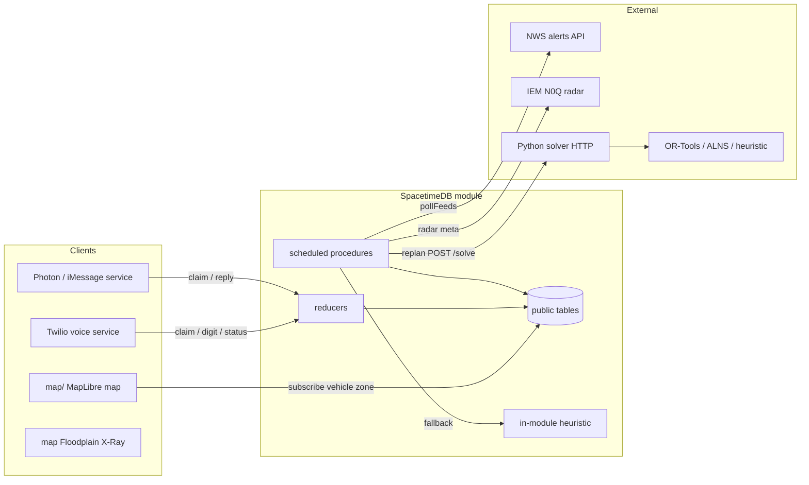
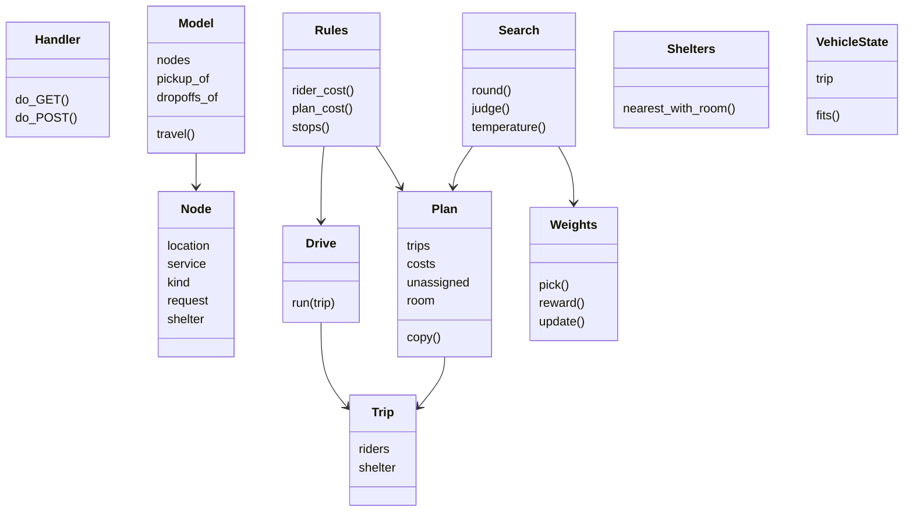
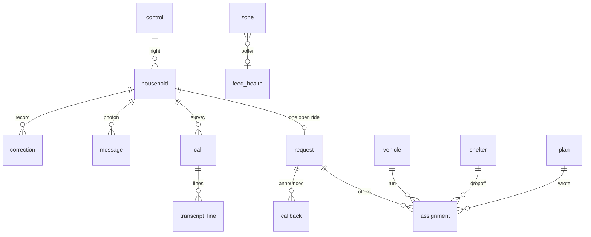
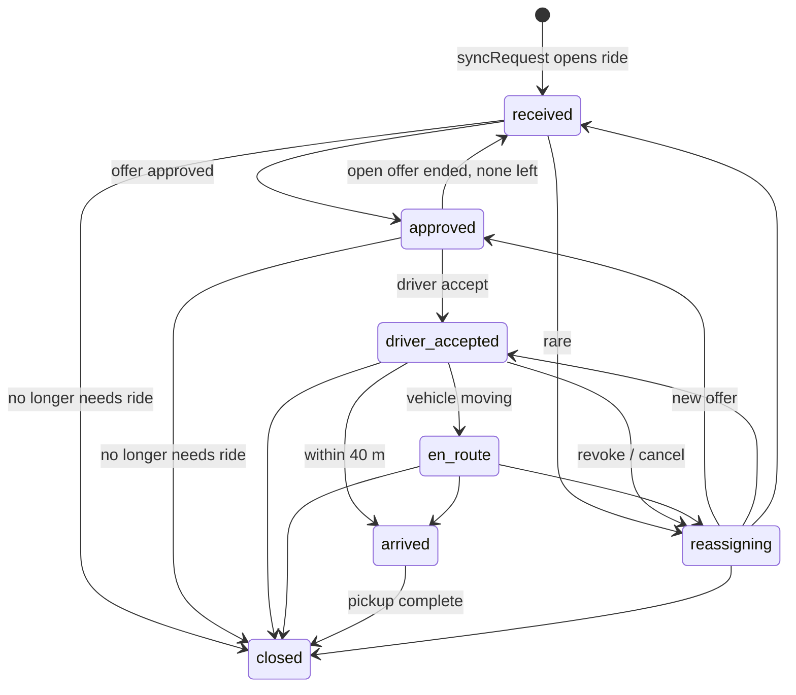

# DialEvac system design

HackUTD / State Farm: when a disaster hits thousands of people at once, identify the most urgent needs, coordinate assistance, and ensure no one is overlooked.

SpacetimeDB is the source of truth. Reducers and scheduled procedures own every write. Voice (Twilio), messaging (Photon / iMessage), the route solver, and the live map are clients of that contract.

---

## 1. High-level design

### 1.1 Problem

A hazard warning puts homes in a zone. The system texts and calls each home, learns who needs a ride and what kind, and dispatches vehicles. Every line a resident hears or reads is a template keyed by request status. Generated text never decides what is promised.

| Prompt | Where it lives |
| --- | --- |
| Identify the most urgent needs | `urgency()` ranks every home. Time left before the hazard comes first, then mobility / oxygen / household size, then a 0–1 prior from records. Survey calls carry that rank; the voice service places the highest first. |
| Coordinate assistance | Ride requests, offers, driver accepts, re-plans on road closures and record corrections, status callbacks. Requests are served earliest deadline first. |
| Ensure no one is overlooked | `accountFor()` puts every in-zone home in exactly one account. Every 30 seconds a sweep recounts them into `coverage` and restarts the ladder for anyone nobody is reaching. Picking up the phone is not being reached: a home counts once a record says whether it can leave. |

### 1.2 System context



### 1.3 Architectural principles

1. **One writer.** Reducers are the only writers. Status strings are checked against unions in `domain/`. A row never holds a value outside those unions.
2. **Honesty.** `statusLine()` is the only source of rider-facing promises. A model never writes a promise. Free-text replies are stored and answered with the current status line.
3. **Idempotency.** Callbacks are keyed `requestId:assignmentId:status`. A retried reducer never calls a rider twice. Driver accept is version-checked: unless the offer is still `offered`, it fails with `"changed"`.
4. **Compatibility before assignment.** `vehicleCanServe` is enforced at plan write, at record correction, and in the solver's `allowedVehicles`.
5. **Frozen accepted runs.** An accepted pickup is not moved. The planner may only add stops after the last accepted `stopOrder`. Revocation happens only when no route reaches the rider in time, a road closes, needs change beyond the vehicle, or the driver cancels.
6. **Live feed is map-only.** `pollFeeds` upserts `zone` rows. It never calls `applyZone`, so NWS polygons produce zero outreach.
7. **Stand-ins by default.** Simulated 555 numbers, simulated drivers, and optional simulated dispatch. Services never contact a 555 number.

### 1.4 Night lifecycle

```mermaid
sequenceDiagram
  participant Op as Operator
  participant M as Module
  participant R as Reach ladder
  participant V as Voice / Photon
  participant D as Dispatcher
  participant Dr as Driver

  Op->>M: importRiders / seedTornadoDemo
  Op->>M: issueWarning(hazard)
  M->>M: stamp warningAt, hazardAt per home
  M->>R: startReachLadder for every in-zone home
  R->>V: survey text (all homes, parallel)
  R->>V: survey call, retry 2 min, retry 5 min
  V->>M: recordDigit / receiveMessage
  M->>M: applyRecord then syncRequest
  Note over M: canLeave false opens a request
  loop every 5s or on road change
    D->>D: buildWorld, solve, writePlan
    D->>Dr: offer (2 min expiry)
  end
  Dr->>M: acceptOffer
  M->>V: one callback + one Photon message
  M->>M: vehicles move; arrived then closed
  loop every 30s
    M->>M: sweepCoverage, restart overlooked ladders
  end
```

1. Warning (or a simulated tornado seed) marks homes in the zone and starts each home's reach ladder.
2. Every home gets a survey text at once. Then a call, a retry at 2 minutes and another at 5, then the door-check list. Calls are paced: a step waits while the home's last call is still queued. A home still unreached near hazard time goes to door checks without waiting (25 minutes for wildfire, 4 for tornado).
3. A keypad or text answer updates the household. That opens a ride request with mobility, crew size, lift, oxygen, and a deadline from the hazard.
4. `replan` runs every 5 seconds and whenever a road closes. It snapshots the world, asks the solver (or the in-module heuristic), and commits through `writePlan`. An accepted run is frozen.
5. A driver accepts or declines. Offers expire after 2 minutes. Accepting moves the request to `driver_accepted` and queues one callback.
6. Corrections are logged. When a correction makes an accepted vehicle unfit, the assignment is revoked and the resident is told. An offer the driver never accepted ends silently.

### 1.5 Runtime topology

| Process | Role | Default |
| --- | --- | --- |
| SpacetimeDB module | Tables, reducers, schedules, NWS poller, fallback heuristic | Maincloud `hackutd-535md` or local `hackutd` |
| `services` voice | Places Twilio calls, answers webhooks | `:8080` |
| `services` messaging | Photon outbound + inbound | iMessage or terminal |
| `dispatch` HTTP | OR-Tools / ALNS / heuristic solver | `:8799` |
| `map/` static | The only map: MapLibre globe, live NWS warnings, fleet, opt-in IEM radar | `127.0.0.1:4178` |

Module env (installed at publish, not from `.env`): `SOLVER_URL`, `SOLVER_TOKEN`, `FEED_AREA`. Leaving them unset is valid: the module plans with its heuristic and the feed stays off until `start_feeds` with `FEED_AREA`.

---

## 2. Folder-level design

```
HackUTD/
├── SYSTEM_DESIGN.md          this document
├── README.md                 setup, checks, how a night runs
├── .env.example              secrets for services (never git)
├── spacetimedb/              source of truth (TypeScript module)
├── services/                 Twilio + Photon Node processes
├── dispatch/                 Python route solver
└── map/                      the only map (MapLibre; live warnings + illustrative hazards)
```

### 2.1 `spacetimedb/`

The published module. Every client depends on the schema and the reducers exported from `src/index.ts`.

```
spacetimedb/
├── package.json              spacetimedb 2.14.1, vitest
├── tsconfig.json
├── vitest.config.ts
├── src/
│   ├── index.ts              default-export schema; init; re-export reducers
│   ├── schema.ts             tables, scheduled tables, env
│   ├── core.ts               transaction helpers, status moves, callbacks
│   ├── households.ts         riders, zone, records, calls, messages
│   ├── reach.ts              survey ladder + coverage sweep
│   ├── plans.ts              writePlan / approve / proposePlan
│   ├── offers.ts             driver accept / decline / cancel / expire
│   ├── dispatch.ts           replan procedure, world snapshot, solver HTTP
│   ├── roads.ts              closures bump roadVersion
│   ├── loop.ts               night, stand-ins, seed, heartbeat
│   ├── feeds.ts              NWS poller, replay, map-only zones
│   └── domain/               pure rules (no db)
│       ├── status.ts         request/assignment state machine
│       ├── need.ts           load, crew, lift, compatibility
│       ├── urgency.ts        call-order score
│       ├── coverage.ts       one account per in-zone home
│       ├── hazard.ts         radial arrival, tornado timing
│       ├── geo.ts            haversine, ray-cast, closures
│       ├── honesty.ts        rider-facing lines
│       ├── script.ts         survey copy
│       ├── problem.ts        solver I/O types
│       └── heuristic.ts      in-module fallback dispatcher
└── tests/
    ├── contract.test.ts      status, compatibility, dispatch contract
    ├── coverage.test.ts      accounts, overlooked restart
    ├── feeds.test.ts         NWS upsert, cancel, stale, no outreach
    └── night.ts              2,000-home night harness
```

**Layering.** `domain/` is pure. `core.ts` is the only shared transaction helper. Feature files call `core` + `domain`. `index.ts` is the export surface. Tests import the same functions the module runs.

### 2.2 `services/`

Two Node processes that talk to the outside world. They depend on `Contract`, not on generated bindings, so they typecheck and test without a live database. `db.ts` is the only file that imports `module_bindings`.

```
services/
├── package.json              generate, messaging, voice, test
├── src/
│   ├── contract.ts           interface the runners depend on
│   ├── db.ts                 DbConnection + subscriptions
│   ├── env.ts                .env, allowlist, fictional 555
│   ├── messaging.ts          Photon send / receive
│   ├── voice.ts              Twilio queue + webhooks
│   ├── twilio.ts             REST placeCall, HMAC signature, TwiML
│   └── module_bindings/      generated (gitignored)
└── tests/services.test.ts
```

### 2.3 `dispatch/`

HTTP solver. The module POSTs the problem JSON from `domain/problem.ts` and falls back to `domain/heuristic.ts` when this service is unset, slow, or down.

```
dispatch/
├── server.py                 ThreadingHTTPServer, /solve /health
├── solver.py                 OR-Tools dial-a-ride
├── heuristic.py              trip-packing greedy (competent baseline)
├── alns.py                   adaptive large neighborhood search
├── fatality.py               assumed expected-deaths objective
└── tests/test_solver.py      feasibility, compatibility, closures
```

Policy selection: `problem.policy` ∈ `{ortools, heuristic, alns}`. Default `ortools`. Auth: optional `Authorization: Bearer SOLVER_TOKEN`.

### 2.4 `map/`

The only map. MapLibre globe, USGS elevation, live NWS warnings and fleet from SpacetimeDB (default local `hackutd-richardson`; `?uri=wss://maincloud.spacetimedb.com&db=hackutd-535md` reads Maincloud). HAND flood tiles and the storm / hurricane layers are illustrative. One hazard mode at a time; IEM radar is opt-in.

```
map/
├── index.html
├── assets/
│   ├── app.js                light mode, exclusive hazard chips, animation loop
│   ├── hazard-tornado.js     live warnings, fleet, opt-in IEM radar, Richardson simulation controls
│   ├── spacetime.js          generated bundle (gitignored)
│   ├── sun.js                solar elevation for day/night
│   ├── base-style.js / style.js
│   ├── data.js / footprints.js
│   ├── flood.js              household HAND values
│   ├── hazard-flood.js       HAND color-relief
│   ├── hazard-storm.js
│   ├── hazard-hurricane.js
│   └── vendor/maplibre-gl.*
├── src/spacetime.ts          typed client; module_bindings/ generated (gitignored)
├── tiles/flood/              Terrarium-encoded HAND tiles
├── tools/build_flood.py      HAND from OSM creeks + USGS 3DEP
└── tools/serve.py
```

---

## 3. Object model and OOP

The TypeScript module is **functional with an explicit object model**, not class-heavy OOP. Domain types are records + unions. Tables are the persisted objects. Python dispatch uses classes and dataclasses.

### 3.1 Design patterns in use

| Pattern | Where | What it does |
| --- | --- | --- |
| **Source of truth / single writer** | schema + reducers | Only reducers mutate rows |
| **State machine** | `domain/status.ts` + `moveRequest` | Legal request/assignment transitions |
| **Strategy** | `dispatch/server.py` `POLICIES` | ortools / heuristic / alns behind one `/solve` |
| **Template method / honesty** | `statusLine` | Status chooses the spoken/texted line |
| **Factory** | `control()`, `feedHealth()`, `insertHousehold()` | Idempotent singleton / row creation |
| **Facade / ports** | `services/src/contract.ts` | Voice and Photon never import bindings |
| **Optimistic concurrency** | `accept`, `claimCall`, `claimMessage` | `"changed"` if the row left the expected state |
| **Idempotent outbox** | `queueCallback` unique `key` | Duplicate callbacks dropped |
| **Scheduled actor** | `reachStep`, `replanJob`, `tickSchedule`, `feedPoll`, `offerExpiry` | Work resumes after restart |
| **Snapshot then commit** | `replan` procedure | `withTx(buildWorld)` → HTTP → `withTx(commit)` |
| **Plugin registry** | `map/assets` `HAZARDS.push` | Flood / storm / hurricane register themselves |
| **ALNS operators** | `alns.py` `DESTROY` / `REPAIR` / `Weights` | Roulette-wheel destroy/repair |
| **Warm start** | OR-Tools `_solve_warm` | Heuristic routes then open-offer routes |

### 3.2 Core TypeScript types (`core.ts`)

```ts
type Schema = InferSchema<typeof spacetimedb>
type Tx = Pick<ReducerCtx<Schema>, "db" | "timestamp" | "random">
type Household = row of household
type Request    = row of request
type Assignment = row of assignment
type Vehicle    = row of vehicle
type Control    = row of control
```

These are the objects every reducer transaction shares. Helpers take `tx: Tx` so a reducer and a procedure's `withTx` call the same functions.

### 3.3 Domain value objects

| Type | File | Fields |
| --- | --- | --- |
| `Needs` | need.ts | `people`, `mobility`, `assistance`, `oxygen` |
| `Load` | need.ts | `seats`, `wheelchairSpaces`, `stretcherSpaces` |
| `VehicleFit` | need.ts | `Load` + `crew`, `lift` |
| `Point` | geo.ts | `lat`, `lng` |
| `RadialHazard` | hazard.ts | `origin`, `firstArrivalMinutes`, `metersPerMinute` |
| `UrgencyInputs` | urgency.ts | `minutesLeft`, `mobility`, `oxygen`, `people`, `needProbability` |
| `AccountInputs` | coverage.ts | `canLeave`, `reach`, `request`, `ladderRunning` |
| `Ride` | honesty.ts | `driverName`, `vehicleKind`, `crew`, `etaMinutes` |
| `Problem` / `Solution` / `PlannedStop` | problem.ts | solver I/O |
| `FeedZone` | feeds.ts | NWS / replay polygon + metadata |
| `PlannedOffer` / `PlanWrite` | plans.ts | dispatcher commit batch |

Unions (closed sets, used as enums):

- `Mobility`: `walks | walker | wheelchair | bedbound`
- `Assistance`: `none | one_person | two_person_lift`
- `Hazard`: `wildfire | flood | hurricane | tornado | earthquake`
- `RequestStatus`: `received | approved | driver_accepted | en_route | arrived | closed | reassigning`
- `AssignmentStatus`: `proposed | offered | accepted | declined | expired | replaced | revoked | cancelled | completed`
- `Account`: `leaving_on_own | helped | help_requested | escalated | door_check | reaching | overlooked`
- `Escalation`: `medical | hazard_at_home | address_unconfirmed | language_barrier | unservable`
- `FeedKind`: `live | simulated | replay`

### 3.4 Python classes (`dispatch/`)



`fatality.py` is a pure functions module (no classes): `party_size`, `deaths_if_unserved`, `expected_deaths`.

### 3.5 Service objects

- `Contract` interface: port for voice and messaging.
- `callQueue()`: priority queue object `{ push, take }` — callbacks outrank surveys (`CALLBACK_PRIORITY = MAX_SAFE_INTEGER`).
- `env`: grouped config objects (`spacetime`, `photon`, `voice`, `twilio`, `allowlist`).

---

## 4. Data model (schema)

All listed tables except `dispatch_state` and the schedule tables are `public: true` (clients may subscribe). Statuses are strings validated in `domain/`.

### 4.1 Entity relationship



### 4.2 Tables

| Table | Key | Purpose |
| --- | --- | --- |
| `control` | `id=0` singleton | Hazard, warning clock, stand-in flags, origin, spread |
| `household` | `id` autoInc, `riderId` unique, `phone` btree, `inZone` btree | Rider record |
| `correction` | `householdId` btree | Field-level before/after with source |
| `call` | `householdId`, `phase` btree | Survey / callback calls; `priority` = `urgency()` |
| `transcript_line` | `callId` | Spoken text + request status at the time |
| `message` | `householdId`, `state` btree | Photon in/out |
| `request` | `householdId` unique, `status` btree | One ride per household |
| `vehicle` | `id` | Fleet + lat/lng |
| `shelter` | `id` | Dropoff with remaining capacity |
| `plan` | `id` | Solver name, timing, fallback reason |
| `assignment` | `requestId`, `vehicleId`, `status` btree | Offer / accept / revoke |
| `callback` | `key` unique | One announced status per request+assignment |
| `road_closure` | `externalId` unique, `active` btree | Blocks legs within 150 m of the point |
| `zone` | `externalId` unique, `source` btree, `active` btree | Map polygons (simulated / live / replay) |
| `feed_health` | `id=0` | NWS poll freshness, warning count, radar time |
| `audit_log` | `id` | Kind + message |
| `dispatch_state` | `id=0` private | `running`, `lastReplanAt`, `roadVersion` |
| `coverage` | `id=0` | Sweep totals; `overlooked` must stay at zero |

**Zone columns (append-only migration).** Original: `id, externalId, source, name, event, severity, rings, active, at`. Appended with `.default(undefined)`: `headline, issuedAt, expiresAt, url, messageType, kind, geometryJson, area`. Optional defaults serialize as Option::None so Maincloud upgrades preserve existing rows.

### 4.3 Scheduled tables

| Table | Trigger | Job |
| --- | --- | --- |
| `tick_schedule` | every 1 s while night is live | `tick` → `heartbeat` |
| `reach_step` | ladder delays | `runReachStep` |
| `replan_job` | due / road bump | `replan` procedure |
| `offer_expiry` | 120 s after approve | `expireOffer` |
| `feed_poll` | every 120 s | `pollFeeds` procedure |

### 4.4 Control flags

| Flag | Default | Effect |
| --- | --- | --- |
| `simulateVoice` | true | Simulated homes answer their own calls; 555 never hits Twilio |
| `simulateDispatch` | false (tornado seed sets true) | Nearest compatible vehicle, no solver |
| `simulateDrivers` | true | Simulated vehicles accept after 6 s |
| `autoApprove` | true | `proposed` → `offered` inside `writePlan` |

---

## 5. Low-level design — domain algorithms

Pure functions. No database. Change these and the solvers / module stay in step.

### 5.1 Geography (`domain/geo.ts`)

| Function | Algorithm |
| --- | --- |
| `metersBetween(a, b)` | Haversine, Earth radius 6,371,000 m |
| `driveSeconds(a, b)` | `round(meters × 1.35 / 11 m/s)` — detour factor stands in for a road graph |
| `insideRing(point, ring)` | Ray casting on GeoJSON `[lng, lat]` rings |
| `insidePolygon(point, rings)` | Inside outer ring and not inside any hole |
| `metersToSegment(p, a, b)` | Point-to-segment on a local equirectangular projection around `a` (cos(lat) × 111,320 m/deg lng, 110,540 m/deg lat) |

### 5.2 Hazard arrival (`domain/hazard.ts`)

Stand-in hazard: reaches the origin `firstArrivalMinutes` after the warning, then spreads outward at `metersPerMinute`.

```
minutesUntilHazard(home) = firstArrivalMinutes + metersBetween(home, origin) / metersPerMinute
deadline = hazardAt − DEADLINE_MARGIN_MINUTES   // 10 minutes
```

| Hazard | firstArrivalMinutes | metersPerMinute | door-check lead |
| --- | --- | --- | --- |
| wildfire (control default) | 20 | 60 | 25 min |
| tornado (`TORNADO_TIMING`) | 8 | 800 | 4 min |

`timingForHazard("tornado")` returns tornado numbers so `startNight` does not reuse wildfire timing. Other hazards keep the control record.

`doorCheckLeadMinutes(hazard)` — tornado 4, else 25. If `minutesLeft ≤ lead` and the home is still unreached, the ladder sends it to door checks immediately.

### 5.3 Need / compatibility (`domain/need.ts`)

Boarding seconds: walks 120, walker 300, wheelchair 600, bedbound 1200. Two-person lift uses bedbound boarding.

```
loadFor:
  wheelchair → { seats: people-1, wheelchairSpaces: 1, stretcherSpaces: 0 }
  bedbound   → { seats: people-1, wheelchairSpaces: 0, stretcherSpaces: 1 }
  else       → { seats: max(1, people), 0, 0 }

crewFor: 2 if two_person_lift or bedbound, else 1
liftFor: wheelchair or bedbound
weightFor: (3 if lift else 1) + 1 if two_person_lift + 1 if oxygen

vehicleCanServe(vehicle, needs):
  seats, wheelchairSpaces, stretcherSpaces, crew all fit
  and (vehicle.lift or rider does not need a lift)
```

`isMobility` / `isAssistance` are type guards. Unknown strings coerce to `walks` / `none` on import.

### 5.4 Urgency (`domain/urgency.ts`)

Who to call first when there are more people than phone lines.

Windows `[120, 60, 30]` minutes: count of windows the home is already inside. Windows are 100 apart; everything inside one window sums below 100, so a tighter window always outranks needs.

```
window        = |{ L in [120,60,30] : minutesLeft < L }|
vulnerability = MOBILITY_WEIGHT[mobility] + 2·oxygen + clamp(people,0,6)/3 + 3·clamp(needProbability,0,1)
sooner        = 1 − clamp(minutesLeft, 0, 240) / 240
urgency       = window·100 + vulnerability·9 + sooner·9

MOBILITY_WEIGHT: walks 0, walker 1, wheelchair 2, bedbound 3
```

`needProbability` is the prior from records (medical registry / policy file) before anyone is asked.

### 5.5 Coverage accounts (`domain/coverage.ts`)

Exactly one account per in-zone home. Priority:

1. `canLeave === true` → `leaving_on_own`
2. request `closed` → `helped`
3. request has `escalation` → `escalated`
4. request exists → `help_requested`
5. `reach === "door_check"` → `door_check`
6. ladder or open call running → `reaching`
7. else → `overlooked`

Overlooked homes are reset to `reach: "idle"` and the ladder is restarted.

### 5.6 Request state machine (`domain/status.ts`)



`canMove(from, to)` allows identity or a listed edge. `moveRequest` is the only writer. Announced statuses (`driver_accepted`, `reassigning`) queue a callback.

Assignment statuses: `proposed → offered → accepted | declined | expired | replaced`. From `accepted`: `revoked | cancelled | completed`.

`OPEN_OFFER = proposed | offered`. `LIVE_ASSIGNMENT = proposed | offered | accepted`.

### 5.7 Honesty (`domain/honesty.ts`)

| Status | Line |
| --- | --- |
| `received` / `approved` | On the list, no driver yet, plus safety sentence |
| `driver_accepted` / `en_route` | Vehicle kind, crew words, ETA, driver name. Falls back to received if no ride |
| `reassigning` | Driver can no longer reach you; still at the top of the list |
| `arrived` | Your driver has arrived |
| `closed` | Your pickup is complete |

`soundsLikePromise(text)` regex-blocks free-text promises (`on the way`, `help is coming`, …). Survey copy lives in `script.ts` (`SURVEY_INTRO`, `SURVEY_ASK`, `KEYPAD_ASK`). Keypad and Photon share the same numbers 1–4.

### 5.8 In-module heuristic (`domain/heuristic.ts` `solveHeuristic`)

Safe fallback when the solver service is down. One household per trip (does not pack). Python `heuristic.py` is the competent packer; keep them conceptually aligned but they are not identical.

1. Sort requests: reassigned first, then earliest deadline.
2. For each request, among `allowedVehicles` that fit load, pick the vehicle whose clock reaches the rider soonest, then the nearest shelter with room.
3. Drop if no legal pickup before `vehicle.endBy`.
4. After dropoff, vehicle clock jumps to the shelter + 120 s unload.

---

## 6. Low-level design — module functions

### 6.1 `core.ts` — transaction helpers

| Function | Logic |
| --- | --- |
| `nowMs` / `at` / `later` | Timestamp ↔ epoch ms |
| `audit` | Insert `audit_log` |
| `control` | Get-or-insert singleton `id=0` (wildfire, UTD origin 32.9857, −96.7502) |
| `needsOf` | Coerce row → `Needs` |
| `hazardAtFor` | `warningAt + minutesUntilHazard` |
| `deadlineFor` | `hazardAt − 10 min`, else 90 min from now |
| `minutesLeft` | Minutes until hazard, or `Infinity` |
| `urgencyOf` | `urgency({ ...needs, minutesLeft, needProbability })` |
| `requestStatus` | Parse or throw |
| `liveAssignments` | Assignments for a request in given statuses |
| `setAssignment` | Status + `decidedAt` |
| `queueCallback` | Unique key; insert pending callback; `queueMessage` with `statusLine` |
| `queueMessage` | Outbound `state=queued` |
| `moveRequest` | `canMove` or `SenderError`; announced → callback |
| `endOpenOffer` | Silent end; if no live assignment left and status is `approved` → `received` |
| `revokeAccepted` | Revoke/cancel accepted; request → `reassigning` (announced) |
| `syncRequest` | Open request if `inZone && canLeave === false`; refresh needs; revoke unfit accepted; replace unfit open offers; close if no longer needs a ride and nothing accepted |
| `runAt` | `ScheduleAt.time` |
| `lineFor` | Status line with accepted driver if any |

Constants: `CONTROL_ID = 0`, `OFFER_SECONDS = 120`.

### 6.2 `households.ts` — riders, zone, channels

| Export | Kind | Logic |
| --- | --- | --- |
| `importRiders` | reducer | Upsert by `riderId`; coerce mobility/assistance |
| `insertHousehold` | fn | Defaults: `inZone false`, `reach idle`, `canLeave undefined`, people 1, oxygen false, needProbability 0 |
| `applyZone` | fn | Ray-cast every home; on enter, stamp `hazardAt` and start ladder if night started; `syncRequest` |
| `setZone` | reducer | Parse GeoJSON polygon coordinates JSON |
| `applyRecord` | fn | Log `correction` when a field changes; set `reach=reached`; `syncRequest` |
| `updateRecord` | reducer | |
| `escalate` | reducer | Set request.escalation from `ESCALATIONS` |
| `claimCall` | reducer | `queued → ringing` + providerId |
| `callAnswered` | reducer | `ringing → live` |
| `endCall` | fn | Phase `ended` + outcome. Pickup alone does not mark reached |
| `callEnded` | reducer | |
| `addTranscriptLine` | reducer | Stores current request status |
| `markCallback` | reducer | `placed \| played \| unanswered` |
| `claimMessage` | reducer | `queued → sending` |
| `messageSent` / `messageFailed` | reducers | |
| `handleReply` | fn | Photon inbound: digits 1–4 → `applyRecord`; else keep text and reply with status line or survey |
| `handleDigit` | fn | Same 1–4 map as Photon |
| `recordDigit` | reducer | On valid digit, `endCall(..., "answered")` |
| `receiveMessage` | reducer | |
| `closeRequest` | reducer | → `closed` |

Reply map:

| Digit | Patch |
| --- | --- |
| 1 | `canLeave: true` |
| 2 | `canLeave: false`, `mobility: walks` |
| 3 | wheelchair + one_person |
| 4 | bedbound + two_person_lift |

### 6.3 `reach.ts` — ladder and coverage

Ladder steps:

| Index | Kind | Delay from previous |
| --- | --- | --- |
| 0 | message | 0 |
| 1 | call | 0 |
| 2 | call | 120 s |
| 3 | call | 300 s |
| 4 | door_check | 300 s |

| Function | Logic |
| --- | --- |
| `startReachLadder` | If `reach === idle`, set `calling`, schedule step 0 |
| `runLadderStep` | Abort if not calling / not in zone. If hazard within door-check lead → door_check. If a call is `queued/ringing/live` and this step is not the text, wait 15 s. Text queues `SURVEY_INTRO + SURVEY_ASK`. Call inserts with `priority: urgencyOf`. |
| `runReachStep` | scheduled reducer |
| `sweepCoverage` | Count accounts; restart overlooked; rewrite `coverage` singleton |

### 6.4 `plans.ts` — the only plan writer

`writePlan(tx, PlanWrite)`:

1. Insert `plan` row.
2. Revoke named accepted assignments.
3. Replace named open offers (silent).
4. For each offer: vehicle must exist and `vehicleCanServe`; request must have no live assignment; `stopOrder` must be after last accepted stop on that vehicle. Insert `proposed`. If `autoApprove`, call `approve`.
5. Escalate named households with `unservable` if they have no escalation yet.

`approve(tx, assignmentId)`: `proposed → offered`, stamp `offeredAt`, `received → approved`, schedule `offerExpiry` at 120 s. **No callback** — the rider hears nothing until a driver accepts.

`proposePlan` reducer: external / test entry into `writePlan`.

### 6.5 `offers.ts` — driver's side

| Export | Logic |
| --- | --- |
| `accept` | Must be `offered`; request not closed. Set `accepted`, replace other live offers, `moveRequest(..., "driver_accepted")` with eta, clear escalation |
| `approveOffer` | reducer → `approve` |
| `acceptOffer` | reducer → `accept` |
| `declineOffer` | `offered` → silent `declined` |
| `cancelByDriver` | `accepted` → `revokeAccepted(..., "cancelled")` |
| `expireOffer` | scheduled: still `offered` or `proposed` → `expired` |

Double-accept: the second `acceptOffer` throws `"changed"`; one accepted assignment and one confirmation callback remain.

### 6.6 `dispatch.ts` — real dispatcher

Constants: replan every 5 s, solver timeout 4 s, shift 6 h, closure radius 150 m. Open request statuses: `received | approved | reassigning`.

| Function | Logic |
| --- | --- |
| `requestReplan(now)` | No-op if already running. Else if due, forced, or `roadVersion !== roadVersionSeen`, set `running` and insert `replanJob` |
| `buildWorld` | Free vehicles (none with accepted assignment). Open requests with no accepted assignment. Locations = vehicles + homes + shelters. Matrix cell is `null` if a closure is within 150 m of the segment, else `driveSeconds`. Each request: load, boarding, deadline seconds from now, weight, `allowedVehicles` via `vehicleCanServe`, `openOfferVehicle`, `maxRideSeconds=3600` if oxygen, `reassigned` if status is reassigning. Policy `"alns"`, time limit 3 s. |
| `solve` | Empty requests → empty heuristic. No URL → in-module heuristic. Else POST `/solve` with optional bearer. Non-OK / bad shape / throw → heuristic + `fallbackReason` |
| `unreachable` | Accepted pickups whose straight line is closed or `now + driveSeconds > deadline` |
| `commit` | Revoke unreachable; first-dropoff trip of each route becomes new offers (skip if same vehicle already offered or already accepted); replace other open offers; escalate late / dropped; `writePlan`; clear `running`, stamp `lastReplanAt`, copy `roadVersionSeen` |
| `replan` | procedure: `withTx(buildWorld)` → `solve` via `ctx.http` → `withTx(commit)`. On commit throw, clear `running` and audit |

### 6.7 `roads.ts`

`upsertClosure` — insert or flip `active`; no-op if unchanged. `bumpRoads` increments `roadVersion` and `requestReplan(true)`. Sources: `manual | driver | resident | feed`.

### 6.8 `loop.ts` — night and stand-ins

| Export | Logic |
| --- | --- |
| `startNight` / `issueWarning` | Validate hazard; bump `generation`; apply tornado timing if any; stamp `hazardAt` for in-zone homes; start ladders; schedule tick |
| `setStandIns` | Voice / dispatch / drivers / autoApprove flags |
| `setHazardOrigin` | Origin + spread |
| `endNight` | Clear `warningAt`, bump generation (tick stops) |
| `seedTown` / `seedStandInTown` | Random homes around origin (555 phones); fleet of 4 vehicles only if `vehicle.count()===0`; one shelter if empty |
| `warningAreaAround` | ~3 km GeoJSON box |
| `seedTornadoIncident` / `seedTornadoDemo` | Public reducer seeds the idempotent `sim-tornado` map scenario with outreach and dispatch flags off. The internal harness can opt into `applyZone`, the wheelchair request, and the operational tornado night for follow-up workflow tests. |
| `standInRecord` | 70% walks; oxygen only if bedbound; prior high if can't walk |
| `tick` | Reschedule if generation matches; `heartbeat` |
| `heartbeat` | Optional stand-in voice/drivers/dispatch; `moveVehicles`; else `requestReplan(false)`; coverage sweep every 30 s |
| `standInVoice` | 25% no-answer; else applyRecord from seeded mobility; mark simulated messages/callbacks delivered |
| `standInDrivers` | Accept after 6 s |
| `moveVehicles` | Straight line at 11 m/s toward next accepted pickup. ≤40 m → arrived then closed, assignment completed. Else interpolate and `en_route` |
| `standInDispatch` | Earliest deadline, nearest compatible free vehicle, `writePlan` solver `"stand-in"` |

### 6.9 `feeds.ts` — live map feed (zero outreach)

NWS `https://api.weather.gov/alerts/active?area=&event=Tornado Warning`. IEM radar meta for `radarValidAt`. Poll every 120 s.

| Function | Logic |
| --- | --- |
| `parseNwsResponse` / `parseAlerts` | Keep Tornado Warning / Emergency if Actual or Cancel. Preserve Polygon / MultiPolygon / null geometry. |
| `liveKind(kind, source)` | Explicit `kind==="live"`, or missing kind only if `source==="nws"`. Legacy `stand-in` rows are not live. |
| `applyZones` | Upsert by `externalId`. Cancel/expiry deactivates and keeps prior fields. Reconciliation deactivates unseen **live** rows of this provider/area only. |
| `commitFeed` | On failure: `stale=true`, keep existing polygons, no deactivate. On success: apply, count live warnings. |
| `pollFeeds` | procedure: fetch outside tx, `withTx(commitFeed)`, reschedule. **Never `applyZone`.** |
| `startFeeds` | Idempotent: insert `feedPoll` only if count is 0 |
| `replayWarning({phase})` | `appear \| update \| disappear` on `replay-tornado-dfw`, `kind=replay` |

### 6.10 `index.ts` exports

`init` → `control(ctx)` only (no schedules until a reducer starts them).

Reducers / procedures: `proposePlan`, `approveOffer`, `acceptOffer`, `declineOffer`, `cancelByDriver`, `expireOffer`, `importRiders`, `setZone`, `updateRecord`, `escalate`, `claimCall`, `callAnswered`, `callEnded`, `addTranscriptLine`, `markCallback`, `recordDigit`, `claimMessage`, `messageSent`, `messageFailed`, `receiveMessage`, `closeRequest`, `runReachStep`, `closeRoad`, `reopenRoad`, `replan`, `issueWarning`, `setStandIns`, `setHazardOrigin`, `endNight`, `seedStandInTown`, `seedTornadoDemo`, `tick`, `pollFeeds`, `startFeeds`, `replayWarning`.

CLI names are snake_case (`seed_tornado_demo`, `start_feeds`, `issue_warning`, …).

---

## 7. Low-level design — solver service

### 7.1 HTTP (`server.py`)

- `GET /health` → `{ok: true}`
- `POST /solve` body = `Problem` JSON, max 20 MB. Bearer token compared with `hmac.compare_digest` when `SOLVER_TOKEN` is set.
- `POLICIES = {ortools: solver.solve, heuristic: heuristic.solve, alns: alns.solve}`
- 400 bad problem, 401 bad token, 413 too large, 500 crash (module falls back)

### 7.2 Fatality objective (`fatality.py`)

Assumption, not a prediction. Mirrors `weightFor` in TypeScript.

```
deaths_if_unserved = people × min(0.9, 0.2 × weight)
expected_deaths    = worst × clamp(seconds_late / 600, 0, 1)
                     seconds_late = boardingTime − deadline
                     None (unserved) = worst
RAMP_SECONDS = 10 minutes = DEADLINE_MARGIN_MINUTES
```

### 7.3 OR-Tools (`solver.py`)

Dial-a-ride with pickup + one of many shelter dropoffs.

**Graph.** Per vehicle: start node. Shared end node. Per request: one pickup + one dropoff per shelter.

**Costs (seconds of vehicle time as the unit):**

| Term | Value | Role |
| --- | --- | --- |
| `DEATH_COST` | 10,000,000 | One expected death outweighs driving |
| `WAIT_COST_PER_WEIGHT_SECOND` | 1 | Waiting costs `weight` seconds of driving (`mu`) |
| `UNSERVED_SURCHARGE` | 2 h | Prefer a late pickup over dropping (then escalate) |
| `CHANGED_OFFER_COST` | 600 s | Moving an open offer must save 10 vehicle-minutes (`nu`) |
| `REASSIGNED_DROP_COST` | 2 h | Extra drop penalty for riders told they are still first |
| `REASSIGNED_WAIT_FACTOR` | 4 | Their wait counts 4× so they ride the next trip |

**Constraints.** Capacity dimensions for seats / wheelchair / stretcher. Time + lateness dimensions (soft upper bounds). Pickup–dropoff same vehicle, pickup before dropoff, optional `maxRideSeconds`. Shelter remaining capacity. Disjunction lets a request go unperformed at `drop_penalty`.

**Search.** Parallel cheapest insertion + guided local search. Warm start: heuristic routes, else keep-open-offer routes. Time limit from `timeLimitSeconds` (module sends 3).

### 7.4 Competent heuristic (`heuristic.py`)

Earliest deadline first; reassigned first. Each vehicle carries **trips** (pickups then one shelter). A rider joins the open trip if load, shelter room, and max ride times all fit; else the vehicle drops off first. Keep an open offer unless another vehicle is 10 minutes faster or is the only one in time. Late-but-reachable riders wait until everyone in time is placed, then a second pass.

Classes: `Shelters` (remaining room), `VehicleState` (clock, open trip).

### 7.5 ALNS (`alns.py`)

Starts from the heuristic plan and never returns a worse objective than the best seen.

**Destroy:** random, worst-cost, related (place + deadline), whole-trip.

**Repair:** cheapest insertion (inside a trip or new trip); choice is greedy or regret-2 (rider who loses most by waiting).

**Acceptance:** simulated annealing. Start temperature ≈ 5% of driving cost. Operators scored (new best 33, better 9, accepted worse 13) and reweighted every 25 rounds (`REACTION = 0.2`).

Classes: `Rules`, `Drive`, `Trip`, `Plan`, `Insertion`, `Weights`, `Search`.

---

## 8. Low-level design — services and maps

### 8.1 Voice (`services/src/voice.ts`, `twilio.ts`)

1. Subscribe to queued calls and pending callbacks.
2. Skip fictional `+1xx555xxxx` numbers (stand-in voice in the module handles them).
3. `callQueue` sorts by priority descending; callbacks always first. `pace` takes `VOICE_CALLS_PER_SECOND` (default 1) jobs per second.
4. Claim then `placeCall`. Allowlist miss → `not_allowed` / `unanswered`.
5. Webhooks (Twilio HMAC-SHA1 signature):
   - `POST /twilio/survey` → TwiML Gather 1 digit
   - `POST /twilio/digit` → `recordDigit`
   - `POST /twilio/callback` → Say the templated `callback.line`
   - `POST /twilio/status` → `outcomeFor` (`completed` + machine → voicemail)

`mayContact`: never 555; else `CONTACT_ALLOWLIST` contains `*` or the number.

### 8.2 Messaging (`messaging.ts`)

`onQueuedMessage` → `claimMessage` → Photon `space.send` or terminal log → `messageSent` / `messageFailed`. Inbound Photon text → `receiveMessage`. Claim races: `"changed"` means another sender won.

### 8.3 Live map (`map/src/spacetime.ts`, `map/assets/hazard-tornado.js`)

One subscription: `vehicle`, `zone`. Markers keyed by `vehicle.id`. Zones keyed by `externalId`.

`displayKind(row) = row.kind || row.source`. Colors: live/nws rust, simulated/stand-in gold, replay purple. Last-resort color is **simulated**, so a legacy stand-in row is not painted as a live warning.

Geometry: prefer `geometryJson` (Polygon or MultiPolygon); else parse `rings`. Inactive zones are removed from the map. Empty vs stale: HUD says “0 tornado warnings” vs “stale” while keeping last good polygons.

Buttons: Start simulation / Reset (`seedTornadoDemo`), enabled only for a local `uri`. Optional IEM N0Q raster overlay, off by default; the raster source is added only while enabled.

### 8.4 MapLibre map (`map/`)

Connected to the local demo module by default. `app.js` owns light mode (solar elevation), hazard chips, and the single `requestAnimationFrame` loop. `hazard-tornado.js` keeps live NWS polygons in `tornado-warnings` and the Richardson scenario in two separate sources: immutable track/impact/label geometry and one moving point.

The deterministic Richardson track is centered on `[-96.758, 32.977]`, passes immediately south of UTD, and runs for 12 seconds. Start seeds `sim-tornado`, writes static scenario geometry once, centers the camera once, and enters **During catastrophe**. Only the point source changes while it moves. At the last waypoint the point stops and the UI enters **After catastrophe**, retaining the impact area. Reset empties both scenario sources. The scenario owns no timer; it consumes the existing animation tick, so repeated runs cannot accumulate intervals. The public seed leaves calls, requests, assignments, voice simulation, and dispatch disabled.

**HAND flood (`build_flood.py` + `hazard-flood.js`).** Named OSM creeks rasterized; USGS 3DEP elevation; per pixel `HAND = elevation − nearest creek elevation` (5×5 min on the creek). Distance > 450 m → HAND 60 m (never floods). Tiles Terrarium-encoded z12–14. Runtime water level oscillates; homes with `hand < L` count as in water. Illustrative, not hydraulic.

Storm and hurricane modules register on `HAZARDS` and add style layers + tick HUD text.

---

## 9. Cross-cutting flows

### 9.1 Dispatch from wheelchair request (contract)

1. `applyRecord(..., { canLeave: false, mobility: wheelchair, ... })` → `syncRequest` inserts `received`.
2. Replan / stand-in dispatch → `writePlan` → `proposed` → auto `approve` → `offered`, request `approved`. **No callback.**
3. Incompatible vehicle is rejected at `writePlan` (`vehicleCanServe`).
4. `acceptOffer` → one `accepted` assignment, request `driver_accepted`, one callback + one message keyed so a retry is a no-op.
5. Second accept on a replaced offer → `"changed"`.

### 9.2 Correction that breaks a vehicle

`applyRecord` logs `correction`, `syncRequest` sees `vehicleCanServe` fail:

- accepted → `revokeAccepted` → rider hears reassigning
- open offer → silent `replaced`

### 9.3 Scale (from the night test)

2,000 stand-in homes, 1 call/s, hazards 25–67 minutes out. Urgency order reached 91% of homes that can't leave by phone vs 87% arrival order. Call rate dominates order: 3 calls/s reached 93% and cut door checks roughly in half. Four stand-in vehicles serve ~50 of ~800 ride requests in that night (fleet size, not a dispatcher limit).

---

## 10. Bindings, publish, tests

Client bindings: `spacetime generate --lang typescript --out-dir … --module-path spacetimedb --no-config` into `map/src/module_bindings` and `services/src/module_bindings`.

Maincloud publish (preserve data, break old clients so they reconnect):

```bash
FEED_AREA=TX spacetime publish hackutd-535md --module-path spacetimedb --server maincloud --yes=remote --break-clients
```

Do not pass `--delete-data`. New zone columns are appended with Option-none defaults.

| Check | Proves |
| --- | --- |
| `cd spacetimedb && npm test` | Status moves, compatibility, frozen runs, one live offer, idempotent callbacks, corrections, solver fallback, closures, Photon/keypad, NWS zones, urgency, coverage, 2,000-home night |
| `cd services && npm test` | Allowlist, Twilio signatures, TwiML escape, urgency-first queue |
| `cd dispatch && uv run --with pytest pytest tests` | Feasible routes, wheelchair compatibility, closures |

---

## 11. Intentionally not built

- Conversational voice agent (Claude + Cartesia). Survey calls use keypad until ported.
- A road graph. Drive times are straight-line × 1.35; a closure blocks any leg within 150 m of the point.
- Production operations UI. `map/` is the only map: live warnings and fleet, with illustrative flood, storm and hurricane layers.
)
